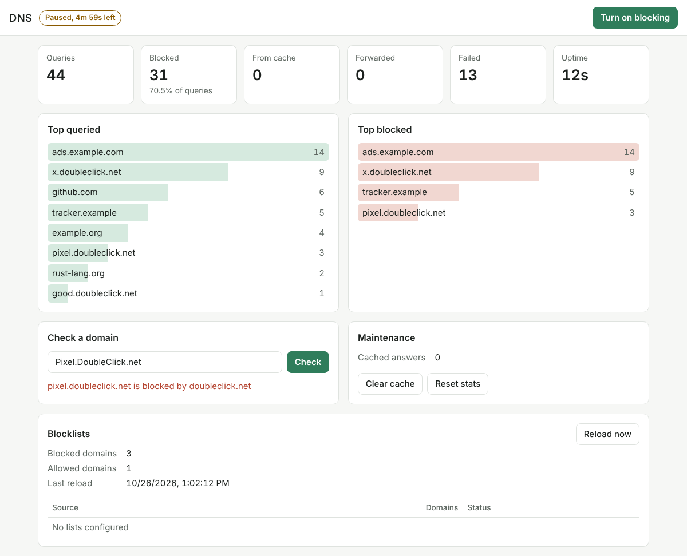

# dns

[](https://github.com/mustafa-zidan/dns/actions/workflows/ci.yml)
[](https://github.com/mustafa-zidan/dns/actions/workflows/docker.yml)
[](https://github.com/mustafa-zidan/dns/pkgs/container/dns)
[](https://github.com/mustafa-zidan/dns/pkgs/container/dns)
[](https://www.rust-lang.org)
[](#license)
[](#features)

A DNS server written in Rust, focused on ad blocking and privacy. Inspired by [Technitium DNS Server](https://technitium.com/dns/).

It sits between your devices and an upstream resolver. Queries for domains on your blocklists never leave your network; everything else is forwarded upstream and cached.

## Features

- UDP and TCP listeners, with TC-bit truncation for oversized UDP answers.
- DNS-over-TLS and DNS-over-HTTPS (HTTP/2 and HTTP/1.1, GET and POST) for your own devices, with certificates reloaded from disk when they are renewed.
- Encrypted upstreams: DNS-over-TLS (the default, to Cloudflare and Quad9) and DNS-over-HTTPS, plus plain UDP/TCP. Upstreams are tried in order with failover.
- Upstream hostnames are resolved through configurable bootstrap servers, never through the OS resolver, so the server can safely be its own host's resolver.
- TTL-aware cache with min/max TTL clamping and RFC 2308 negative caching.
- Blocklists from URLs or files, refreshed on a schedule. Hosts files, plain domain lists and adblock-style `||domain^` / `@@||domain^` rules are understood. A rule blocks the domain and all its subdomains.
- Inline denylist and allowlist. The allowlist always wins.
- Blocked names answered with NXDOMAIN, `0.0.0.0` / `::`, or REFUSED.
- Privacy: queries sent upstream get a fresh random ID and source port and carry none of the client's EDNS options, so EDNS Client Subnet never leaks your network. Encrypted queries are padded to 128-byte blocks (RFC 8467) so their size doesn't reveal the name. DoH requests send no User-Agent. Nothing is logged per query unless you turn on debug logging.

## Running with Docker

Images are published to GitHub Container Registry for `linux/amd64` and `linux/arm64`.

```sh
docker run -d --name dns -p 53:53/udp -p 53:53/tcp ghcr.io/mustafa-zidan/dns:latest
```

The image ships with [`config/dns.toml`](config/dns.toml). To use your own, mount it over `/etc/dns/dns.toml`:

```sh
docker run -d --name dns -p 53:53/udp -p 53:53/tcp \
  -v "$PWD/dns.toml:/etc/dns/dns.toml:ro" \
  ghcr.io/mustafa-zidan/dns:latest
```

The container runs as a non-root user.

## Encrypted DNS for your devices

Set `tls.cert_file` and `tls.key_file` to a PEM certificate chain and private key, then turn on the listeners you want:

```toml
[tls]
cert_file = "/etc/dns/tls/fullchain.pem"
key_file = "/etc/dns/tls/privkey.pem"
dot_listen = ["0.0.0.0:853"]   # DNS-over-TLS, for Android "Private DNS" and similar
doh_listen = ["0.0.0.0:443"]   # DNS-over-HTTPS at https://<name>/dns-query
```

The certificate must cover the name your devices connect to, so use one from a public CA (for example Let's Encrypt) or a CA your devices trust. The server checks the files every `tls.reload_interval_secs` (default one hour) and picks up a renewed certificate without a restart. If the new files don't load, it keeps serving the old certificate and logs the error.

In Docker, mount the certificate directory and publish the ports:

```sh
docker run -d --name dns -p 53:53/udp -p 53:53/tcp -p 853:853/tcp -p 443:443/tcp \
  -v "$PWD/dns.toml:/etc/dns/dns.toml:ro" \
  -v "/etc/letsencrypt/live/dns.example.com:/etc/dns/tls:ro" \
  ghcr.io/mustafa-zidan/dns:latest
```

The container user must be able to read the key file. Let's Encrypt's `live` directory holds symlinks into `archive`, so mount the parent `/etc/letsencrypt` instead if the links don't resolve inside the container.

Responses to padded queries are padded to 468-byte blocks (RFC 8467). DoH answers carry a `Cache-Control: max-age` equal to their smallest TTL.

## Running from source

```sh
cargo run --release -- --config config/dns.toml
```

Binding port 53 usually needs root or `CAP_NET_BIND_SERVICE`; for local testing change `server.listen` to a high port such as `127.0.0.1:5353`.

## Configuration

Everything is in one TOML file, passed with `--config` or the `DNS_CONFIG` environment variable. Every key is optional. See [`config/dns.toml`](config/dns.toml) for all options and their defaults.

Logging is controlled by `DNS_LOG` using [`tracing` filter syntax](https://docs.rs/tracing-subscriber/latest/tracing_subscriber/filter/struct.EnvFilter.html), for example `DNS_LOG=dns=debug` to see each blocked name and cache hit.

## Dashboard

The dashboard is a separate web app in [`web/`](web/), published as its own image, `ghcr.io/mustafa-zidan/dns-dashboard`. It calls the server's API from the browser. It shows:

- query counts and the share that was blocked
- the top queried and top blocked domains
- the state of each blocklist

From it you can turn blocking off or pause it, check whether a domain is blocked, reload the lists, clear the cache and reset the stats.



The quickest way to run both is the [compose example](examples/compose/): set a token in `dns.toml`, run `docker compose up -d`, and open <http://localhost:8080>.

To run the dashboard on its own, tell it where the browser reaches the API:

```sh
docker run -d --name dns-dashboard -p 8080:8080 \
  -e DNS_API_URL=http://localhost:8053 \
  ghcr.io/mustafa-zidan/dns-dashboard:latest
```

On the server, add the dashboard's address to `api.cors_origins` and set `api.token`:

```toml
[api]
listen = "0.0.0.0:8053"
token = "change-me"
cors_origins = ["http://localhost:8080"]
```

Leave `DNS_API_URL` unset to have the dashboard ask each visitor for a server address. It asks for the token on first use and keeps it only for that browser tab. The page loads nothing from other sites, and its Content-Security-Policy only lets it call the configured API.

## HTTP API

The server exposes a small JSON API, on `127.0.0.1:8053` by default. If `api.token` is set, every request except `/api/health` needs an `Authorization: Bearer <token>` header.

| Method | Path | What it does |
|---|---|---|
| GET | `/api/health` | Liveness check |
| GET | `/api/stats?top=10` | Query counts (blocked, cached, forwarded, failed), blocked ratio, top queried and top blocked domains |
| DELETE | `/api/stats` | Reset the counters |
| GET | `/api/blocking` | Whether blocking is active, rule counts, last reload and per-list status |
| PUT | `/api/blocking` | `{"enabled": false}` turns blocking off, `{"enabled": false, "pause_secs": 300}` pauses it for 5 minutes, `{"enabled": true}` turns it back on |
| POST | `/api/blocking/reload` | Re-download the blocklists now |
| GET | `/api/check?name=ads.example.com` | Whether a name is blocked, and by which rule |
| GET | `/api/cache` | Number of cached answers |
| DELETE | `/api/cache` | Empty the cache |

```sh
curl -s localhost:8053/api/stats | jq
curl -s -X PUT localhost:8053/api/blocking -H 'content-type: application/json' \
  -d '{"enabled": false, "pause_secs": 300}'
```

Stats live in memory only and reset on restart. Set `stats.top_domains = false` to keep no per-domain counts at all.

Other web pages can't drive the API through your browser. Requests that carry an `Origin` must come from the API's own address or from one listed in `api.cors_origins`. Without a token, the `Host` must also be an IP address or `localhost`, which stops DNS rebinding. So without a token, reach the API by IP address or `localhost`, not by a hostname.

## Roadmap

- Per-client rules.

## Development

```sh
cargo fmt --check
cargo clippy --all-targets -- -D warnings
cargo test
cargo test --test live -- --ignored   # queries real public resolvers
```

See [CONTRIBUTING.md](CONTRIBUTING.md) for how to contribute, and [SECURITY.md](SECURITY.md) for reporting vulnerabilities.

## License

Licensed under either of

- Apache License, Version 2.0 ([LICENSE-APACHE](LICENSE-APACHE))
- MIT license ([LICENSE-MIT](LICENSE-MIT))

at your option.

Unless you explicitly state otherwise, any contribution intentionally submitted for inclusion in this project by you, as defined in the Apache-2.0 license, shall be dual licensed as above, without any additional terms or conditions.
