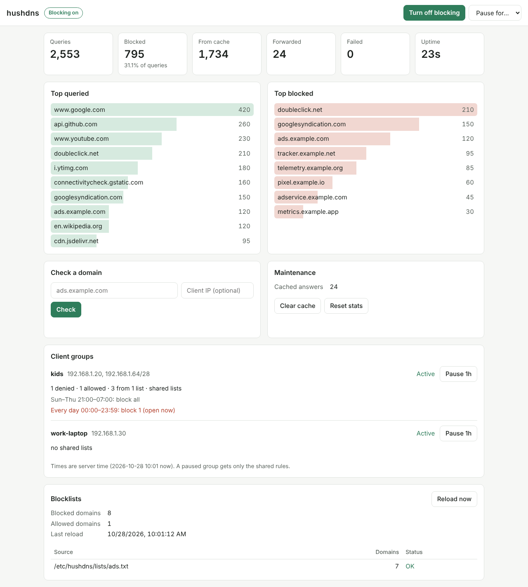

<p align="center"></p>

# hushdns

[](https://github.com/mustafa-zidan/hushdns/actions/workflows/ci.yml)
[](https://github.com/mustafa-zidan/hushdns/actions/workflows/docker.yml)
[](https://github.com/mustafa-zidan/hushdns/pkgs/container/hushdns)
[](https://github.com/mustafa-zidan/hushdns/pkgs/container/hushdns)
[](https://www.rust-lang.org)
[](#license)
[](https://mustafa-zidan.github.io/hushdns/)
[](#features)

hushdns is a DNS server written in Rust, focused on ad blocking and privacy. Inspired by [Technitium DNS Server](https://technitium.com/dns/).

It sits between your devices and an upstream resolver. Queries for domains on your blocklists never leave your network; everything else is forwarded upstream and cached.

**Docs:** <https://mustafa-zidan.github.io/hushdns/>, with install steps for Docker, binaries and Kubernetes, setting up your devices, and every option.

## Features

- UDP and TCP listeners, with TC-bit truncation for oversized UDP answers.
- DNS-over-TLS and DNS-over-HTTPS (HTTP/2 and HTTP/1.1, GET and POST) for your own devices, with certificates reloaded from disk when they are renewed.
- Encrypted upstreams: DNS-over-TLS (the default, to Cloudflare and Quad9) and DNS-over-HTTPS, plus plain UDP/TCP. Upstreams are tried in order with failover.
- Upstream hostnames are resolved through configurable bootstrap servers, never through the OS resolver, so the server can safely be its own host's resolver.
- TTL-aware cache with min/max TTL clamping and RFC 2308 negative caching.
- Blocklists from URLs or files, refreshed on a schedule. Hosts files, plain domain lists and adblock-style `||domain^` / `@@||domain^` rules are understood. A rule blocks the domain and all its subdomains.
- Inline denylist and allowlist. The allowlist always wins.
- Per-client rules: give a device or network its own denylist and allowlist, or let it skip the shared blocklists.
- Blocked names answered with NXDOMAIN, `0.0.0.0` / `::`, or REFUSED.
- Privacy: queries sent upstream get a fresh random ID and source port and carry none of the client's EDNS options, so EDNS Client Subnet never leaks your network. Encrypted queries are padded to 128-byte blocks (RFC 8467) so their size doesn't reveal the name. DoH requests send no User-Agent. Nothing is logged per query unless you turn on debug logging.

## Running with Docker

Images are published to GitHub Container Registry for `linux/amd64` and `linux/arm64`.

```sh
docker run -d --name hushdns -p 53:53/udp -p 53:53/tcp ghcr.io/mustafa-zidan/hushdns:latest
```

The image ships with [`config/hushdns.toml`](config/hushdns.toml). To use your own, mount it over `/etc/hushdns/hushdns.toml`:

```sh
docker run -d --name hushdns -p 53:53/udp -p 53:53/tcp \
  -v "$PWD/hushdns.toml:/etc/hushdns/hushdns.toml:ro" \
  ghcr.io/mustafa-zidan/hushdns:latest
```

The container runs as a non-root user.

## Encrypted DNS for your devices

Set `tls.cert_file` and `tls.key_file` to a PEM certificate chain and private key, then turn on the listeners you want:

```toml
[tls]
cert_file = "/etc/hushdns/tls/fullchain.pem"
key_file = "/etc/hushdns/tls/privkey.pem"
dot_listen = ["0.0.0.0:853"]   # DNS-over-TLS, for Android "Private DNS" and similar
doh_listen = ["0.0.0.0:443"]   # DNS-over-HTTPS at https://<name>/dns-query
```

The certificate must cover the name your devices connect to, so use one from a public CA (for example Let's Encrypt) or a CA your devices trust. The server checks the files every `tls.reload_interval_secs` (default one hour) and picks up a renewed certificate without a restart. If the new files don't load, it keeps serving the old certificate and logs the error.

In Docker, mount the certificate directory and publish the ports:

```sh
docker run -d --name hushdns -p 53:53/udp -p 53:53/tcp -p 853:853/tcp -p 443:443/tcp \
  -v "$PWD/hushdns.toml:/etc/hushdns/hushdns.toml:ro" \
  -v "/etc/letsencrypt/live/dns.example.com:/etc/hushdns/tls:ro" \
  ghcr.io/mustafa-zidan/hushdns:latest
```

The container user must be able to read the key file. Let's Encrypt's `live` directory holds symlinks into `archive`, so mount the parent `/etc/letsencrypt` instead if the links don't resolve inside the container.

Responses to padded queries are padded to 468-byte blocks (RFC 8467). DoH answers carry a `Cache-Control: max-age` equal to their smallest TTL.

## Running on Kubernetes

A Helm chart in [`charts/hushdns`](charts/hushdns/) runs the server and the dashboard. Everything goes through `values.yaml`, including the server's config, so there's no separate config file to manage:

```sh
helm install hushdns oci://ghcr.io/mustafa-zidan/charts/hushdns \
  --set service.type=LoadBalancer
```

See the [chart's README](charts/hushdns/README.md) for TLS with cert-manager, per-client rules, ingress for the dashboard, and how to read the generated API token.

## Binaries

Each [release](https://github.com/mustafa-zidan/hushdns/releases) has Linux binaries for `x86_64` and `aarch64`, with a `SHA256SUMS` file. See [Install](https://mustafa-zidan.github.io/hushdns/install.html#binary) in the docs.

## Running from source

```sh
cargo run --release -- --config config/hushdns.toml
```

Binding port 53 usually needs root or `CAP_NET_BIND_SERVICE`; for local testing change `server.listen` to a high port such as `127.0.0.1:5353`.

## Configuration

Everything is in one TOML file, passed with `--config` or the `HUSHDNS_CONFIG` environment variable. Every key is optional. See [`config/hushdns.toml`](config/hushdns.toml) for all options and their defaults.

## Logs

Logs go to standard output. `HUSHDNS_LOG` picks what is logged, using [`tracing` filter syntax](https://docs.rs/tracing-subscriber/latest/tracing_subscriber/filter/struct.EnvFilter.html), and defaults to `info`. `HUSHDNS_LOG_FORMAT=json` (or `--log-format json`) writes one JSON object per line, ready for Loki, Elasticsearch, `jq` or `kubectl logs | jq`. The default is plain text.

Nothing is logged per query unless you ask for it. `HUSHDNS_LOG=info,hushdns::query=debug` adds one `query` event for every query, always with the same fields:

| Field | Example |
|---|---|
| `name` | `tracker.ads.example.com` |
| `qtype` | `AAAA` |
| `outcome` | `blocked`, `cached`, `forwarded`, `failed` or `invalid` |
| `rcode` | `NoError`, `NXDomain`, `ServFail` |
| `rule` | the rule that blocked it, `*` for a schedule that blocks everything |
| `client_ip` | `192.168.1.20` |
| `client_group` | the `[[clients]]` group whose rules blocked it |
| `transport` | `udp`, `tcp`, `dot` or `doh` |
| `duration_ms` | `0.13` |

```sh
docker logs hushdns | jq 'select(.outcome == "blocked") | .name' | sort | uniq -c | sort -rn
```

Other events use the same names where they apply: `client_ip` and `transport` for connections, `upstream` for upstream servers, `list` for blocklists, `listen` for listeners and `error` for errors. Per-query logs record who looked up what, so turn them on only when you need them.

## Dashboard

The dashboard is a separate web app in [`web/`](web/), published as its own image, `ghcr.io/mustafa-zidan/hushdns-dashboard`. It calls the server's API from the browser. It shows:

- query counts and the share that was blocked
- the top queried and top blocked domains
- the state of each blocklist
- each client group, with its rules, list status and schedules, and which schedules are open now

From it you can turn blocking off or pause it, pause one client group's rules for an hour, check whether a domain is blocked (optionally for a given client address), reload the lists, clear the cache and reset the stats.



The quickest way to run both is the [compose example](examples/compose/): set a token in `hushdns.toml`, run `docker compose up -d`, and open <http://localhost:8080>.

To run the dashboard on its own, tell it where the browser reaches the API:

```sh
docker run -d --name hushdns-dashboard -p 8080:8080 \
  -e HUSHDNS_API_URL=http://localhost:8053 \
  ghcr.io/mustafa-zidan/hushdns-dashboard:latest
```

On the server, add the dashboard's address to `api.cors_origins` and set `api.token`:

```toml
[api]
listen = "0.0.0.0:8053"
token = "change-me"
cors_origins = ["http://localhost:8080"]
```

Leave `HUSHDNS_API_URL` unset to have the dashboard ask each visitor for a server address. It asks for the token on first use and keeps it only for that browser tab. The page loads nothing from other sites, and its Content-Security-Policy only lets it call the configured API.

## Per-client rules

Groups in `[[clients]]` match queries by source address and change what gets blocked for them:

```toml
[[clients]]
name = "kids"
addresses = ["192.168.1.20", "192.168.1.64/28"]
denylist = ["youtube.com", "tiktok.com"]
allowlist = ["school.example"]
lists = ["https://example.com/social-media.txt"]

# Bedtime: on school nights, block everything but the allowlist.
[[clients.schedules]]
days = ["sun", "mon", "tue", "wed", "thu"]
from = "21:00"
to = "07:00"
block_all = true

[[clients]]
name = "work-laptop"
addresses = ["192.168.1.30", "fd00::30"]
blocklists = false   # skip the shared lists; this group's own rules still apply
allowlist = []
```

For a query from a group's address, the group's allowlist is checked first, then any schedule that is open right now, then the group's denylist and its own `lists`, and last the shared `[blocking]` rules unless `blocklists = false`. When an address is in several groups, the most specific network wins.

A schedule opens on the days listed and runs from `from` to `to`. One that ends before it starts runs past midnight, so the bedtime above covers Thursday night into Friday morning but not Friday night. Times are in `server.timezone`, or the system's zone when it's unset. The Docker image runs in UTC, so set `server.timezone` there.

A group's own `lists` load and refresh along with the shared ones, in the same formats. Turning blocking off or pausing it through the API turns off client rules too. You can also pause just one group's rules, so its devices get only the shared rules for a while, from the dashboard or with `PUT /api/clients/<name>`. `/api/check?name=youtube.com&client=192.168.1.20` shows the answer for one client.

The server sees the address the query arrives from. Behind NAT or a DNS proxy, every device looks like that box. In Docker, the published UDP and TCP ports usually keep client addresses, but if every query appears to come from the Docker gateway, run the container with `--network host`.

## HTTP API

The server exposes a small JSON API, on `127.0.0.1:8053` by default. If `api.token` is set, every request except `/api/health` needs an `Authorization: Bearer <token>` header.

| Method | Path | What it does |
|---|---|---|
| GET | `/api/health` | Liveness check |
| GET | `/api/stats?top=10` | Query counts (blocked, cached, forwarded, failed), blocked ratio, top queried and top blocked domains |
| DELETE | `/api/stats` | Reset the counters |
| GET | `/api/blocking` | Whether blocking is active, rule counts, last reload and per-list status |
| PUT | `/api/blocking` | `{"enabled": false}` turns blocking off, `{"enabled": false, "pause_secs": 300}` pauses it for 5 minutes, `{"enabled": true}` turns it back on |
| POST | `/api/blocking/reload` | Re-download the blocklists now |
| GET | `/api/check?name=ads.example.com` | Whether a name is blocked, and by which rule. Add `&client=<ip>` to apply that client's group |
| GET | `/api/clients` | Client groups with their rule counts, list status, schedules (and whether each is open now) and pause state |
| PUT | `/api/clients/<name>` | `{"pause_secs": 1800}` gives the group only the shared rules for 30 minutes, `{"pause_secs": 0}` resumes |
| GET | `/api/cache` | Number of cached answers |
| DELETE | `/api/cache` | Empty the cache |

```sh
curl -s localhost:8053/api/stats | jq
curl -s -X PUT localhost:8053/api/blocking -H 'content-type: application/json' \
  -d '{"enabled": false, "pause_secs": 300}'
```

Stats live in memory only and reset on restart. Set `stats.top_domains = false` to keep no per-domain counts at all.

Other web pages can't drive the API through your browser. Requests that carry an `Origin` must come from the API's own address or from one listed in `api.cors_origins`. Without a token, the `Host` must also be an IP address or `localhost`, which stops DNS rebinding. So without a token, reach the API by IP address or `localhost`, not by a hostname.

## Performance

On a 4-CPU machine, hushdns answers about 215,000 cached and 245,000 blocked queries per second over UDP, 30% to 50% more than 0.0.1 and about three times as many as Technitium DNS Server 15.6.2 under the same load, with a fifth of its memory or less. See [Performance](https://mustafa-zidan.github.io/hushdns/performance.html) for the full table, what changed, how it's measured, and how to run `bench/compare.sh` yourself. Every version tag is benchmarked in CI against the one before it, and pull requests are checked for regressions.

## Roadmap

- Creating and editing client groups from the dashboard, saved across restarts. Today the dashboard shows groups and pauses them, and groups are defined in the config.
- DNSSEC validation.
- An opt-in query history that survives restarts.

## Development

```sh
cargo fmt --check
cargo clippy --all-targets -- -D warnings
cargo test
cargo test --test live -- --ignored   # queries real public resolvers
mdbook serve docs                     # the docs site, at http://localhost:3000
bench/compare.sh v0.0.1 HEAD          # benchmark your changes against a release
```

See [CONTRIBUTING.md](CONTRIBUTING.md) for how to contribute, and [SECURITY.md](SECURITY.md) for reporting vulnerabilities.

## License

Licensed under either of

- Apache License, Version 2.0 ([LICENSE-APACHE](LICENSE-APACHE))
- MIT license ([LICENSE-MIT](LICENSE-MIT))

at your option.

Unless you explicitly state otherwise, any contribution intentionally submitted for inclusion in this project by you, as defined in the Apache-2.0 license, shall be dual licensed as above, without any additional terms or conditions.
