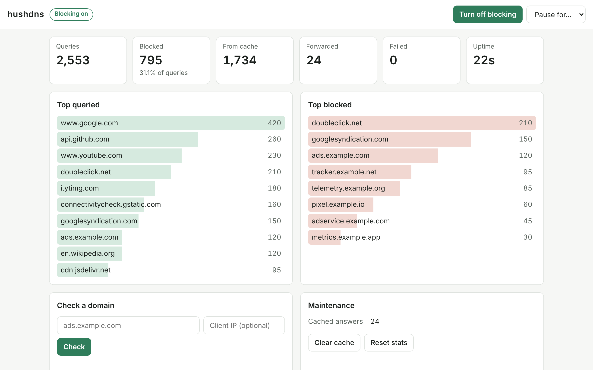
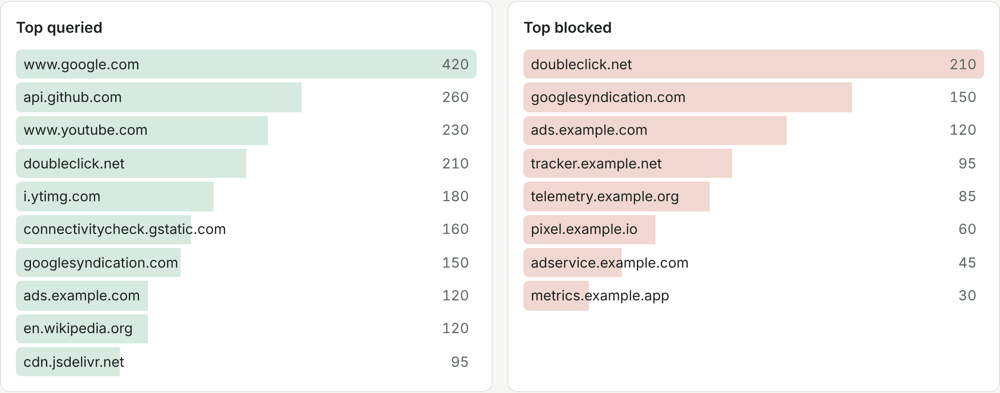
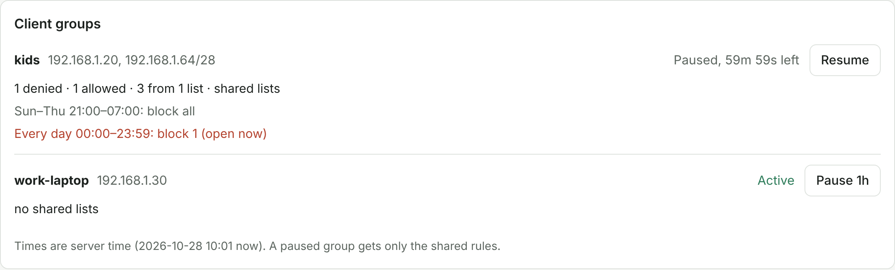
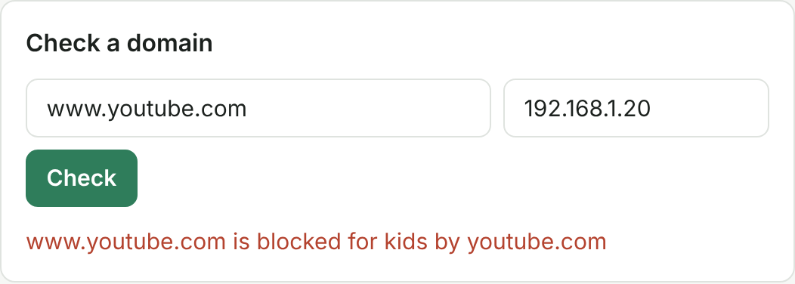
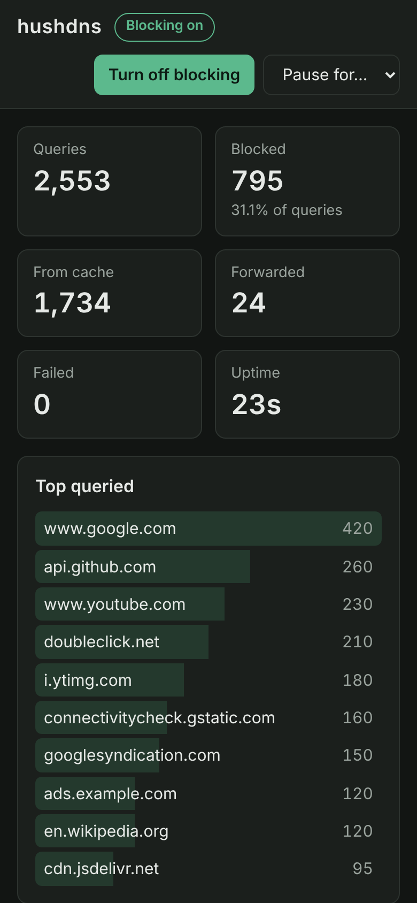

# Dashboard

The dashboard is a separate web app, published as its own image, `ghcr.io/mustafa-zidan/hushdns-dashboard`. It runs in your browser and calls the server's [API](api.md) directly.



## What it shows

- Query counts, and the share that was blocked
- The top queried and top blocked domains
- The state of each blocklist: how many domains it added, when it last loaded, and any error
- Each [client group](clients.md), with its rules, its lists and its schedules, and which schedules are open now



## What you can do from it

- Turn blocking off, or pause it for 5 minutes, 30 minutes or an hour
- Pause one client group's rules for an hour, so its devices get only the shared rules
- Check whether a domain is blocked, and by which rule, optionally for a given client address
- Reload the blocklists, clear the cache and reset the stats





It follows your system's light or dark theme, and works on a phone.

<p align="center"></p>

## Running it

The quickest way is the [compose example](install.md#docker-compose-with-the-dashboard), which runs the server and the dashboard together.

To run the dashboard on its own, tell it where the browser reaches the API:

```sh
docker run -d --name hushdns-dashboard -p 8080:8080 \
  -e HUSHDNS_API_URL=http://localhost:8053 \
  ghcr.io/mustafa-zidan/hushdns-dashboard:latest
```

On the server, set a token and add the dashboard's address to `api.cors_origins`:

```toml
[api]
listen = "0.0.0.0:8053"
token = "change-me"
cors_origins = ["http://localhost:8080"]
```

If you leave `HUSHDNS_API_URL` unset, the dashboard asks each visitor for a server address. It asks for the token on first use and keeps it only in that browser tab.

## Security

The page loads nothing from other sites. Its Content-Security-Policy only lets it call the configured API. On the server's side, the API refuses requests from web pages whose origin isn't listed in `api.cors_origins`. See [HTTP API](api.md#browsers-and-other-web-pages).
